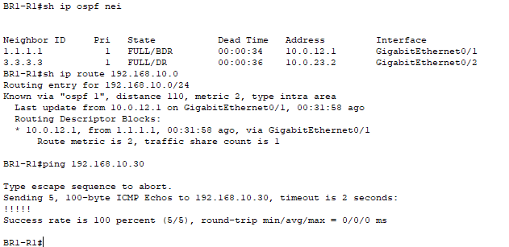
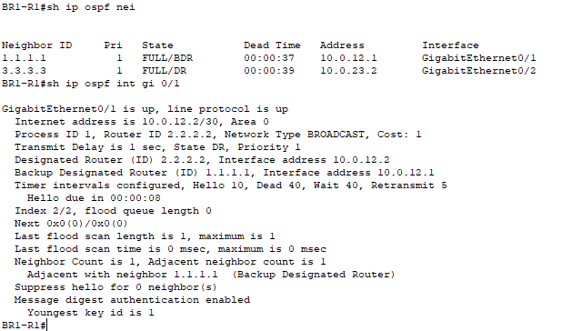
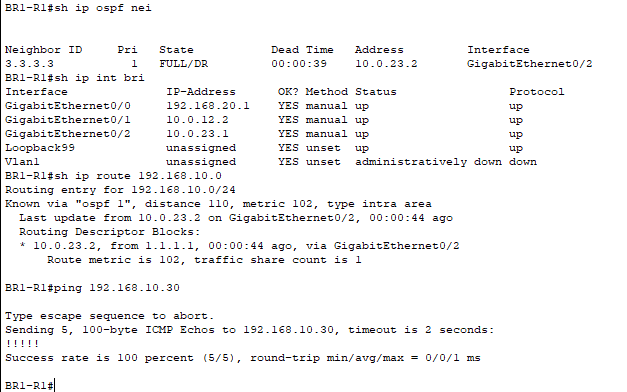
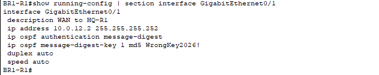
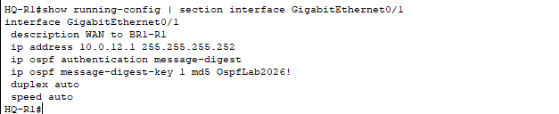
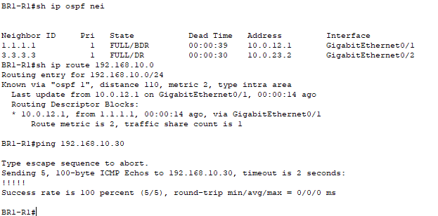

# Multisite OSPF Authentication and Troubleshooting

Configured OSPF message-digest authentication on the BR1–HQ WAN link in Cisco Packet Tracer, introduced a mismatched key, and verified routing failover while the physical interface remained up. Restoring the matching key recovered the OSPF adjacency and preferred route.

## Lab environment

Cisco Packet Tracer 8.2.2 with three Cisco 2911 routers in a triangle: HQ-R1, BR1-R1, and BR2-R1. This project builds on the existing multisite RADIUS failover lab.

| Connection or service | Address / interface |
| --- | --- |
| HQ-R1 toward BR1 | G0/1 — 10.0.12.1/30 |
| BR1-R1 toward HQ | G0/1 — 10.0.12.2/30 |
| BR1-R1 toward BR2 | G0/2 — 10.0.23.1/30 |
| BR2-R1 toward BR1 | G0/2 — 10.0.23.2/30 |
| HQ LAN | 192.168.10.0/24 |
| HQ AAA server | 192.168.10.30 |
| Router IDs | HQ: 1.1.1.1; BR1: 2.2.2.2; BR2: 3.3.3.3 |

The WAN links use OSPF process 1, area 0. The existing higher-cost BR1–BR2 link provides an alternate path to HQ. Authentication was configured only on the BR1–HQ link in this exercise.

## Objectives

- Configure matching interface-level OSPF authentication on two routers.
- Distinguish an OSPF adjacency failure from a physical interface failure.
- Compare authentication settings to identify a key mismatch.
- Verify backup routing and reachability after convergence.
- Restore the matching key and confirm primary-route recovery.

## 1. Establish the baseline

On BR1-R1:

```text
show ip ospf neighbor
show ip route 192.168.10.0
ping 192.168.10.30
```

Both HQ and BR2 were FULL neighbors. BR1 reached the HQ LAN through 10.0.12.1 on G0/1 with OSPF metric 2. The AAA server responded to all five ping requests.



## 2. Enable matching authentication

CLI help confirmed support for message-digest authentication and key IDs 1–255. The following configuration was applied to G0/1 on both BR1-R1 and HQ-R1:

```text
configure terminal
interface gigabitEthernet0/1
ip ospf message-digest-key 1 md5 OspfLab2026!
ip ospf authentication message-digest
end
```

Verification on BR1-R1:

```text
show ip ospf neighbor
show ip ospf interface gigabitEthernet0/1
```

Both neighbors were FULL. Interface output confirmed message-digest authentication was enabled and the youngest key ID was 1.



## 3. Introduce a mismatched key

Only BR1-R1 was changed. Packet Tracer rejected an attempt to overwrite the existing key with `OSPF: Key 1 already exists`, so key 1 was removed before adding its replacement:

```text
configure terminal
interface gigabitEthernet0/1
no ip ospf message-digest-key 1
ip ospf message-digest-key 1 md5 WrongKey2026!
end
```

After allowing convergence in Realtime mode, these commands were run:

```text
show ip ospf neighbor
show ip interface brief
show ip route 192.168.10.0
ping 192.168.10.30
```

The HQ neighbor disappeared, but G0/1 remained up/up. BR2 remained FULL, and the HQ LAN route changed to 10.0.23.2 through G0/2 with metric 102. The AAA server still responded to five of five pings through the alternate route.



## 4. Identify the cause

The interface configurations were compared on both routers:

```text
show running-config | section interface GigabitEthernet0/1
```

| Setting | BR1-R1 | HQ-R1 |
| --- | --- | --- |
| Authentication | message-digest | message-digest |
| Key ID | 1 | 1 |
| Key value during fault | WrongKey2026! | OspfLab2026! |

The authentication mode and key ID matched, but the key values differed. The controlled change, configuration comparison, and subsequent recovery identified the mismatched key as the cause of the adjacency failure.





## 5. Correct and verify recovery

On BR1-R1 only:

```text
configure terminal
interface gigabitEthernet0/1
no ip ospf message-digest-key 1
ip ospf message-digest-key 1 md5 OspfLab2026!
end
```

After convergence, both neighbors returned to FULL. The route to 192.168.10.0/24 returned to 10.0.12.1 through G0/1 with metric 2, and the AAA server responded to all five pings.



Configurations were saved on BR1-R1 and HQ-R1 using `copy running-config startup-config`, and the Packet Tracer project was saved.

## Results

| State | HQ neighbor on BR1 | Route to HQ LAN | AAA server ping |
| --- | --- | --- | --- |
| Baseline | FULL | 10.0.12.1, metric 2 | 5/5 |
| Matching authentication | FULL | Not separately captured in this step | Not separately tested in this step |
| Mismatched key | Absent; G0/1 up/up | 10.0.23.2, metric 102 | 5/5 |
| Matching key restored | FULL | 10.0.12.1, metric 2 | 5/5 |

An operational interface does not guarantee a working routing adjacency. Comparing neighbor state, interface status, routing entries, and authentication configuration isolated the failure and verified recovery.

## Scope and limitations

- This exercise authenticates OSPF control packets on one WAN link; it does not encrypt user traffic or secure every OSPF link in the topology.
- MD5 was used for this Packet Tracer exercise. The displayed keys are disposable lab values and must not be reused in production.
- Pings were tested after convergence. No convergence duration, uninterrupted delivery, or existing-session continuity was measured.
- The AAA server was a reachability target. RADIUS login behavior was not retested in this exercise.
- No packet capture, authentication debug output, or attack simulation was used to establish the result.

## Project file

[Download the Packet Tracer lab](multisite-ospf-authentication.pkt)
